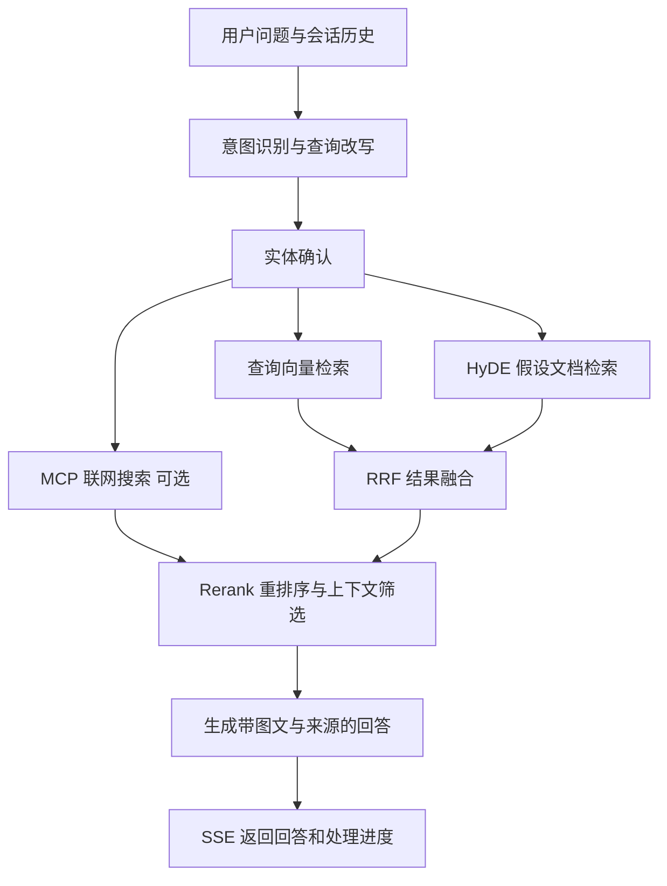

# 多模态 RAG 知识库智能问答系统

面向设备手册、技术文档等资料的知识库问答应用。系统将 PDF 中的文字、图片和表格转为可检索内容，结合 **HyDE 查询增强、稠密与稀疏向量混合检索、RRF 融合和 Rerank 重排序**，生成带图片及原文来源的多轮回答。

通过 **LangGraph** 编排入库与问答流程，**FastAPI + SSE** 返回处理进度和回答内容，提供基于 **Vue 3** 的文档上传与问答页面。

## 核心功能

| 功能 | 实现内容 |
| --- | --- |
| 多模态文档入库 | MinerU 解析 PDF，视觉模型生成图片摘要及表格转写，关联 MinIO 原文件与图片 |
| 切片与实体识别 | 按标题及长度组织片段，补充标题、处理短片段，并提取产品或设备实体 |
| HyDE 查询增强 | 意图识别与追问改写，生成假设文档并与查询检索分支并行执行 |
| 混合检索与排序 | Milvus 保存稠密、稀疏向量并按实体过滤；RRF 融合候选结果，再使用 Rerank 重排 |
| 联网搜索 | 通过 MCP 调用百炼联网搜索工具，补充库外证据，可在配置中关闭 |
| 多轮问答与来源 | PostgreSQL 检查点保存会话，使用 thread_id 接续对话；回答携带图片与原文链接 |
| 入库并发控制 | 图片摘要去重及并发限制；向量化按批处理并校验返回数量 |
| 评测 | 提供 RAGAS 评测脚本，支持使用自备数据进行逐题核查和回归 |

## 系统流程

### 文档入库


### 检索问答



## 技术栈

- **编排与服务**：Python 3.12+、LangChain、LangGraph、FastAPI、SSE。
- **检索与存储**：Milvus、PostgreSQL、MinIO。
- **文档与模型**：MinerU、通义视觉与语言模型、text-embedding-v4、qwen3-rerank。
- **外部工具**：MCP、百炼联网搜索。
- **界面与评测**：Vue 3、Markdown 渲染、RAGAS。

## 目录结构

```text
RAG/
├── agents/
│   ├── ingest/                 # 文档入库图与处理节点
│   ├── query/                  # 查询、检索、融合与回答节点
│   └── prompts/                # 提示词
├── apis/                       # 入库与问答 API
├── clients/                    # PostgreSQL、MinIO、Milvus 客户端
├── integrations/               # 解析、Embedding、Rerank 外部服务
├── repositories/               # 向量数据访问
├── conf/                       # 配置模型与示例
├── docker/                     # 基础服务 Docker Compose
├── eval/                       # 评测脚本
├── templates/                  # 文档上传与问答页面
├── static/                     # 页面静态资源
├── vendors/                    # 第三方 Markdown 切片组件
└── main.py                     # FastAPI 入口
```

## 本地运行

以下命令使用 PowerShell，需要提前安装 Git、uv 和 Docker Compose，并准备 MinerU 与模型服务凭据。

### 1. 获取项目与配置

```powershell
git clone https://github.com/yuanshen-ai/RAG.git
cd RAG
uv sync
Copy-Item conf/app_config.example.yaml conf/app_config.yaml
Copy-Item docker/.env.example docker/.env
Copy-Item docker/milvus/milvus.example.yaml docker/milvus/milvus.yaml
```

编辑三个本地配置文件，将 `YOUR_*` 占位内容替换为自己的值：

| 配置 | 需要设置的内容 |
| --- | --- |
| `conf/app_config.yaml` | MinerU Token、模型 API Key、MinIO、Milvus 与 PostgreSQL 连接信息 |
| `docker/.env` | PostgreSQL 用户、密码和数据库名，以及 MinIO 访问凭据 |
| `docker/milvus/milvus.yaml` | Milvus 连接 MinIO 的 accessKeyID / secretAccessKey，以及 root 初始密码 |

注意保持配置一致：

- 应用的 `postgre.user/password/db_name` 与 Docker PostgreSQL 环境变量一致；示例应用用户与 Docker 示例用户名不同，需要自行统一。
- 应用、Docker 和 Milvus 的 MinIO 访问凭据一致。
- 应用的 `milvus.password` 与 Milvus 的 root 密码一致。
- 所选模型需在自己的服务账号中可用。若不使用联网搜索，将 `query_agent.web_search_enable` 设为 `false`。

### 2. 启动基础服务

```powershell
cd docker
docker compose up -d
docker compose ps
cd ..
```

等待服务就绪。Compose 提供 etcd、MinIO、Milvus 和 PostgreSQL；默认映射包括 MinIO `9000/9001`、Milvus `19530`、PostgreSQL `5433`，以 Compose 文件和本地配置为准。

文档解析使用原文件 URL，MinerU 服务需要能够访问该 URL。远程解析服务无法访问你电脑的 `localhost`，因此实际入库时应配置解析服务可访问的 MinIO 地址和网络。

### 3. 启动应用

在仓库根目录执行：

```powershell
uv run python main.py
```

## 评测与关键实现

基础服务、模型和文档入库准备完成后，准备自己的 CSV 测试数据（包含 `question` 和 `ground_truth` 字段），再指定文件执行评测：

```powershell
uv run python -m eval.ragas_eval -i path/to/your_qa.csv -o eval/local_result.json
```

将命令中的 `path/to/your_qa.csv` 替换为自己的数据文件路径。评测会调用模型服务，结果取决于语料、配置和模型版本；参数和实现见 [评测脚本](eval/ragas_eval.py)。运行生成的评测结果保存在本地，不纳入版本管理。

- [入库流程编排](agents/ingest/graph.py)
- [查询流程编排](agents/query/graph.py)
- [向量生成与并发控制](agents/ingest/nodes/text_to_embedding.py)
- [检索融合](agents/query/nodes/rrf_merge.py) 与 [重排序](agents/query/nodes/chunks_rerank.py)
- [联网搜索 MCP 集成](agents/query/nodes/web_search.py)
- [问答 SSE 接口](apis/query_router.py)

## 配置与数据

真实凭据、上传文件、PDF 解析结果、日志和本地虚拟环境不随仓库分发；本地配置已由 `.gitignore` 排除。MinIO 客户端会为所用存储桶设置匿名读取策略以支持文件引用，演示时请使用可公开的测试文档。
